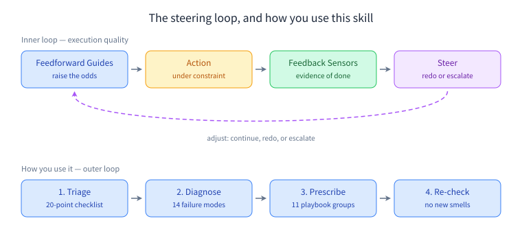

# harness-engineering

English | [简体中文](./README_CN.md)

**Stop re-pasting the same prompt.** This skill diagnoses why your coding agent's output is inconsistent, then rebuilds the harness around it — instruction files, skills, rules, state, feedback loops and environment lock-in.

```
triage (20-point checklist)  →  diagnose (14 failure modes)  →  prescribe (11 playbook groups)  →  re-check
```

<p align="center">
  
</p>

> **Attribution:** 方法论提炼自一门内部方法论课程，讲次编号保留仅为可追溯。The methodology is distilled from an internal methodology course on harness engineering; lecture numbers are kept only for traceability, and no course text is reproduced here.

## Installation

```bash
npx skills add 9Ashwin/harness-engineering
```

## The problem it solves

Most agent failures are not model failures. They are harness failures — and they show up as symptoms you have probably already blamed on the model:

- Output is good one day and bad the next, with nothing changed.
- The agent repeats the same mistake that you already wrote a rule about.
- It says "done" in two minutes; your spot check finds the hard 40% skipped.
- `AGENTS.md` keeps growing and the agent keeps getting *worse*.
- It worked yesterday, then broke on a different machine.
- The rule exists — but only in one person's head.

The core idea: **a harness is the steering loop around the agent.** It decides what context the agent acts in, how the result gets checked, and what happens when the check fails. Feedforward raises the odds of getting it right; feedback supplies the evidence that it *was* right. Neither substitutes for the other. When output disappoints, you fix the missing link in the loop — not the wording of the prompt.

## When to use it

**Use it when:**

- You are writing or changing `AGENTS.md`, a `SKILL.md`, a principles document, a rule registry, an acceptance script, a checkpoint protocol, or an environment bootstrap script.
- The same agent task is flaky, or the same error keeps coming back, or you are about to add rule number N to a rule file that is already too long.
- A weekly or daily workflow is still "paste this prompt every time" and you want it to become a reusable system.
- You are designing acceptance criteria for work that is hard to automate — or you notice that "done" is always declared by whoever produced the work.

**Do not use it when:**

- The task is one-off (draft an email, polish a paragraph, generate an image). Polishing a harness for a task you will never repeat does not pay back.
- The real limit is model capability or task granularity. Change model or shrink the task first; do not pile on more rules.
- You are locating and fixing a specific code bug. That is a debugging workflow, not harness design.
- You are doing prose writing or layout. That is writing work; this skill does not replace it.

## What it covers

The skill ships a triage checklist, 14 failure modes with prescriptions, and 11 prescription groups.

### Diagnosis — 14 failure modes

| # | Failure mode | What you observe | Prescription |
|---|---|---|---|
| 1 | Vague requirements | You give one sentence; the agent returns something that looks right and isn't | **Extract an instruction file** — constraints, completion criteria, edge cases |
| 2 | Implicit conventions | Direction is right, details drift; you keep saying "we do it differently here" | **Establish a principles document** with an explicit precedence order |
| 3 | Information scatter | Precise execution of the wrong target; stale docs are trusted more than no docs | **Manage knowledge dependencies** — source map plus scheduled sync |
| 4 | False victory | "Done" in minutes; spot checks find 60% | **Separate execution from verification** |
| 5 | Instruction file rot | More rules, worse behavior; you cannot point at the offending rule | **Instruction file governance** — registry, conflict detection, periodic cleanup |
| 6 | Feedforward obsession | You add another rule; the same class of error returns | **Feedback first** — write the check, not the process rule |
| 7 | Feedback overload | The agent thrashes, fixing one thing and breaking another | **Grade feedback** — blocking / warning / info, silent on success |
| 8 | Context dumping | Most of the run is searching and cross-checking; little real work | **Context budgeting** — filter, layer, load on demand, compress |
| 9 | Context anxiety | Careful early, sloppy late; verification gets skipped near the window limit | **Dual-loop architecture + checkpoints + inner-loop budget** |
| 10 | Cross-session knowledge loss | Decisions you already settled resurface in the next task | **Dynamic knowledge update** — triage, discovery, decision |
| 11 | State pollution | One-off execution data becomes long-term "fact" | **State separation** — scratchpad vs durable state, single owner |
| 12 | Environment drift | Worked yesterday, not today; "works on my machine" | **Environment locking** — init script, lockfiles, pinned skills, indirect layer |
| 13 | Pattern copy drift | New code mirrors the legacy pattern you are trying to retire | **Pattern baseline** — reference example, failing architecture checks, violation baseline |
| 14 | Skill trigger drift & bloat | The right skill does not fire; two skills compete; the skill keeps growing | **Description = when to use**, four-part completeness, structure before line count |

### Prescription — 11 playbook groups

| Group | What it builds |
|---|---|
| Layering & progressive disclosure | An entry file that routes, with details loaded on demand |
| Feedforward ↔ feedback ratio | The default: turn "must X" into "check whether X holds" |
| Rule governance | A rule registry with priority, expiry, and status; conflict detection that keeps running |
| Writing skills | `description` as the only always-resident competitive slot; four-part completeness; right degree of freedom |
| State & cross-session | Scratchpad vs durable state, single owner, the four things a checkpoint must keep |
| Environment locking | Deterministic bootstrap, pinned dependencies and third-party skills, an indirect layer for external services |
| Grading feedback | Silent on success; blocking / warning / info, with the responsibility split made explicit |
| Examples before conventions | A positive reference, failing checks, a violation baseline, continuous cleanup |
| Repository as spec | The repository is the single source of truth: everything the agent needs lives in files, laid out agent-first |
| Least intervention | Automate the predictable checks; humans adjudicate and escalate instead of scanning every round |
| Knowledge solidification | Whatever the conversation proves out is written back into instructions, state, tools and environment |

## How to use it

1. **Triage.** Run the 20-item checklist in [`SKILL.md` §3](skills/harness-engineering/SKILL.md). It is machine-checkable on purpose: the goal is to turn "the agent feels off" into "item 11 does not hold in this repo". Note which items fail.
2. **Diagnose.** Take the failing items to [`references/diagnoses.md`](skills/harness-engineering/references/diagnoses.md). Each entry has the same five parts: symptom / cause / indicators / prescription / common misdiagnosis. Fix the one or two most painful items, not everything at once.
3. **Prescribe.** The general construction patterns are in [`references/playbook.md`](skills/harness-engineering/references/playbook.md), arranged in 11 groups with before → after shape comparisons.
4. **Re-check.** Go back to step 1. Confirm you did not introduce a new smell — for example, adding a check script for false victory and triggering feedback overload instead.

## Design notes

Two decisions shape everything in here:

- **Feedback first.** When you want to add a control, write its *checkable form* before writing a process rule. A check sits in the feedback link of the loop, so the agent hits it every run; a rule sits in the feedforward link and can be skimmed past. Writing checks first also naturally suppresses instruction bloat.
- **Determinism belongs in code; semantics belong to the model.** Counting, date math, format validation and field completeness should be scripts. Tone, sufficiency of a rationale, and whether a claim is supported stay with the model. Roughly: code should carry the majority of *formalizable* checks, the model the semantic remainder. That split is a cost optimum, not a style preference.

A third, quieter constraint: **fix one or two things per pass.** Almost every failure mode in this skill is reachable by prescriptions that, applied all at once, create a different failure mode.

## Adding to this skill

The skill is designed to grow by increments rather than rewrites. The full convention lives in [`references/course-map.md`](skills/harness-engineering/references/course-map.md); the short version:

1. **Trigger** — a new lecture, a revision to an existing one, or a new claim from the live session or a Q&A.
2. **Classify** — is it a new diagnosis, a new prescription, or a rewrite of an existing claim?
3. **Place** — diagnoses go to `references/diagnoses.md` (keeping the fixed five-part form); prescriptions go to `references/playbook.md` (into the nearest group, or a new group with its boundary stated). Update the mapping table in `references/course-map.md`.
4. **Re-link** — update the indexes in `SKILL.md` §3/§4/§5. Indexes must stay machine-resolvable: names and paths greppable, links clickable.
5. **Record** — append a row to the change log at the bottom of `references/course-map.md`.

Discipline: add, don't reorder. Existing entry numbers are identity, never reused or renumbered. A claim that is overturned gets marked `superseded` and kept, not deleted.

## Repository layout

```
.
├── README.md / README_CN.md
├── LICENSE
├── .claude-plugin/
│   ├── plugin.json
│   └── marketplace.json
├── docs/
│   └── steering-loop.svg
└── skills/
    └── harness-engineering/
        ├── SKILL.md              # the trunk: how to use it, what to check, where to go next
        └── references/
            ├── diagnoses.md      # 14 failure modes: symptom / cause / indicators / prescription / misdiagnosis
            ├── playbook.md       # 11 prescription groups with before → after shapes
            └── course-map.md     # lecture ↔ section mapping, and the increment convention
```

## Provenance & attribution

The methodology in this repository is a distillation of an internal methodology course on harness engineering. Lecture numbers such as "07 讲" appear as provenance tags only — they let a maintainer trace a claim back to its source, and nothing depends on them. No course text is reproduced wholesale: the prose quotes briefly with lecture tags and is otherwise a rewrite, and the examples and code blocks are original or abstracted. This repository contains no project-private data (order numbers, tokens, user IDs, internal addresses); all examples are abstract.

## License

MIT
